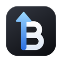

<p align="center">
  
</p>

<h1 align="center">Bitcrane</h1>

<p align="center">
  File transfer for macOS and Windows with automatic folder watching. Published by RaccoonWorks.<br>
  <a href="https://github.com/Raccoon-Works/bitcrane/releases/latest"><strong>Download the latest version</strong></a>
</p>

- Protocols: SFTP (SSH), FTP, FTPS (explicit and implicit TLS), WebDAV (HTTP and HTTPS), SMB 2/3 (Windows shares, NAS), SCP for SSH servers without SFTP
- Cloud services: Dropbox, OneDrive, Google Drive (with your own free app key, see [docs/google-drive.md](docs/google-drive.md))
- Servers and shared settings stay in step between your computers through a folder your own cloud already syncs (passwords optionally, encrypted)
- Two halves: this computer and a server, or two servers (server to server)
- Folder watching: changed files are uploaded automatically, with excludes, a post-upload command and a warning when the server copy is newer
- Upload from the Explorer or Finder context menu ("Upload with Bitcrane")
- Windows: servers as folders in the Explorer, like OneDrive (files download when opened)
- Cryptomator vaults (format 8) on this computer or any server: unlock, browse, transfer, create new ones
- Command line for scripts: `bitcrane upload`, `download`, `ls` with saved servers (see [docs/cli.md](docs/cli.md))
- Transfer queue that survives a restart and resumes partial files
- Host keys and self-signed certificates are confirmed once and remembered
- Passwords and passphrases live in the macOS Keychain or the Windows Credential Manager, never in Bitcrane's files
- Signed automatic updates
- German and English interface

## Download

Get the newest version from the [releases page](https://github.com/Raccoon-Works/bitcrane/releases/latest):
`Bitcrane_<version>_x64-setup.exe` for Windows, `Bitcrane_<version>_universal.dmg` for macOS (Apple Silicon and Intel).
Installed copies update themselves.

Bitcrane is not code-signed yet, so the first start needs one extra step. Updates installed from within Bitcrane do not.

- **macOS:** after moving Bitcrane to Applications, run once in Terminal
  `xattr -dr com.apple.quarantine /Applications/Bitcrane.app`
  (otherwise macOS reports the app as damaged).
- **Windows:** Microsoft Defender SmartScreen shows "Windows protected your PC"
  (German: „Der Computer wurde durch Windows geschützt“). Click "More info" („Weitere Informationen“),
  then "Run anyway" („Trotzdem ausführen“).

## Roadmap

- **Servers as folders in Finder** (Windows already has them in the Explorer): the macOS File Provider interface requires an app extension signed by Apple; it will follow together with notarized macOS releases.
- **Notarized macOS builds and signed Windows builds**: planned. Until then, see the notes under Download.
- **Built-in SSH terminal** with snippets, next to the file view.
- Distribution through the **Microsoft Store**.

## Development

Requirements: Node.js 22, Rust (stable), and the Tauri 2 prerequisites for your platform.

```bash
npm install
npm run dev               # browser prototype with simulated servers on http://localhost:1420
npx tauri dev             # the desktop app
npx tauri build           # installers for the current platform
npm run licenses          # refresh the third-party license list (src/licenses.json)
```

The interface runs in two modes: in the desktop app it talks to the Rust backend (`src/backend/tauriBackend.ts`);
in a plain browser it uses an in-memory file system (`src/backend/mockFs.ts`) so the UI can be tried without servers.

## Structure

| Path | Purpose |
|---|---|
| `src/state/store.ts` | App state, user actions, the browser simulation |
| `src/state/live.ts` | Desktop mode: connections, listings, transfer queue, folder watches |
| `src/state/updates.ts` | Update check and installation |
| `src/i18n.ts`, `src/i18n.en.ts` | Translation helper; German is the source language, English the translation |
| `src/components/` | Main window, panes, sidebar, toolbar, activity, dialogs |
| `src/styles/` | Design tokens and component styles |
| `src-tauri/src/remote.rs` | One interface over SFTP (`ssh.rs`), FTP/FTPS (`ftp.rs`), WebDAV (`dav.rs`), SMB (`smb.rs`) and the cloud services |
| `src-tauri/src/transfer.rs` | Uploads, downloads and server-to-server copies with resume, temp names and versions |
| `src-tauri/src/tls.rs` | Certificate checks (public CAs, otherwise a confirmed fingerprint) |
| `src-tauri/src/watcher.rs` | File system events for folder watches |
| `.github/workflows/build.yml` | Builds the installers and publishes updates (started by hand) |

## Builds and updates

Builds run on GitHub Actions when started by hand. Each build gets the version `0.2.<run number>` and becomes a
release of this repository with notes in sections (Features, Improvements, Fixes), the installers and a signed `latest.json`.
Installed copies look for updates at `releases/latest/download/latest.json` here. The secret
`TAURI_SIGNING_PRIVATE_KEY` signs the update packages.

## Tests

`cargo test` in `src-tauri` runs the unit tests. Integration tests run against real servers when these
variables are set: `BITCRANE_TEST_SSH`, `BITCRANE_TEST_FTP` (`host:plain,explicit,implicit`) and
`BITCRANE_TEST_DAV` (comma-separated URLs).

## License

Bitcrane is free software under the GNU General Public License, version 3 or (at your option) any later version.
See [LICENSE](LICENSE). Third-party components and their licenses are listed in `src/licenses.json`.

## Privacy

Bitcrane connects only to the servers and services you set up yourself, and, for updates, to GitHub
(`github.com/Raccoon-Works/bitcrane/releases`; this can be turned off in Settings › General › Updates).
It sends no usage data or analytics anywhere. Passwords and keys stay in the macOS Keychain or the
Windows Credential Manager on your computer.

## Acknowledgements

Developed by RaccoonWorks with the help of Claude (Anthropic) as a coding assistant.
